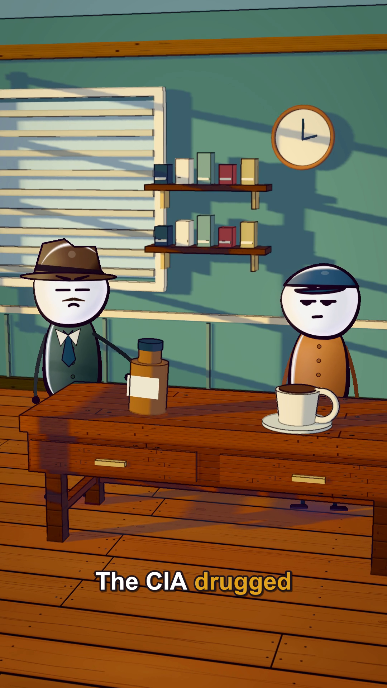
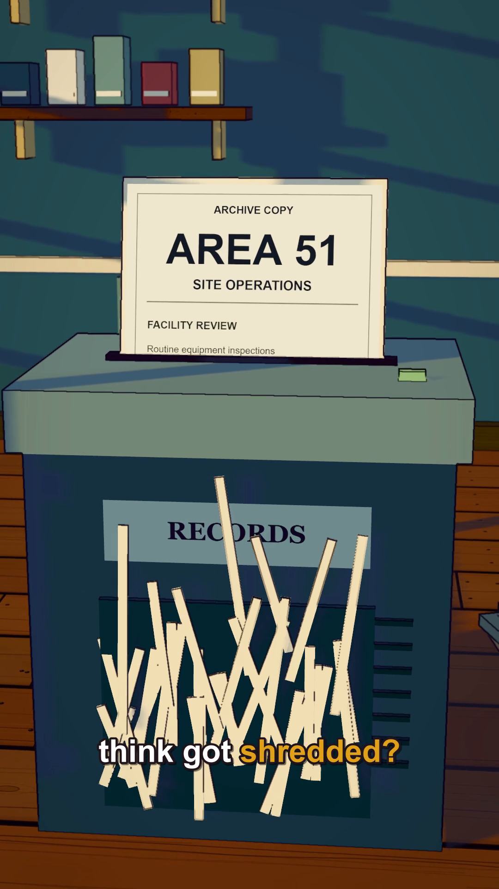

# Preferred karaoke subtitles

Use this style whenever the user requests subtitles. The user does not need to repeat the appearance settings. The skill's default remains no captions unless requested.

These examples and settings live outside story projects and remain available if MKUltra is deleted.

## Approved appearance

- Highlight only the currently spoken word in goldenrod **#DAA520**. Previous and upcoming words stay white **#FFFFFF**. Do not leave already spoken words gold.
- Use bold Arial, 76 px at 1080x1920. Use a dark outline of 4.5 px and a soft shadow of 2.5 px. Scale all dimensions with output resolution.
- Start with short phrases of two to four words, at most two lines. Break at natural speech boundaries. Measure with the actual font; prefer lines under 880 px and keep them under 900 px at 1080 width.
- Start with bottom-centre alignment at **(540, 1660)** on a 1080x1920 canvas. Check the actual scenes and platform safe areas; move captions if they hide faces, important props or document text.
- Preserve narration punctuation and wording. Display numbers naturally, matching combined spoken intervals when several spoken tokens become one displayed number.

## Timing and export

1. Obtain and verify word start/end timestamps against the final narration. Do not estimate uniform word durations.
2. Make a separate ASS event for each active word, colouring that word and resetting the rest to white. ASS uses BGR: goldenrod is `&H0020A5DA&`; white is `&H00FFFFFF&`. Plain accumulating karaoke tags do not reproduce this current-word-only behaviour.
3. During a pause within a displayed phrase, show all words white. Keep events ordered and non-overlapping; verify number merges and phrase transitions.
4. Render a preview frame during an early word and a late word, and inspect short motion clips for synchronisation. Check that previous words return to white and captions stay within safe bounds.
5. Preserve the clean video and create a separate captioned MP4. Copy the audio stream when supported so subtitle encoding does not alter narration or the mix. Keep the ASS and a plain SRT sidecar; SRT alone does not preserve word colouring.
6. Check duration, frame count, audio preservation and visible goldenrod highlighting in the exported video. Do not claim exact synchronisation without reviewing the timing.

## Preserved implementation example

[karaoke-example.ass](../templates/subtitles/karaoke-example.ass) is the complete working ASS from the original rendered example. It is a reference for event structure and styling, **not timing to reuse for another narration**. It references Arial but does not bundle font files. Install or select an available licensed bold font when rendering.

Future projects must generate new timestamps, phrases and ASS events from their own narration. Keep project-specific subtitle generation, timing data and exports inside `projects/<slug>/`; do not import anything from `projects/mkultra`.
